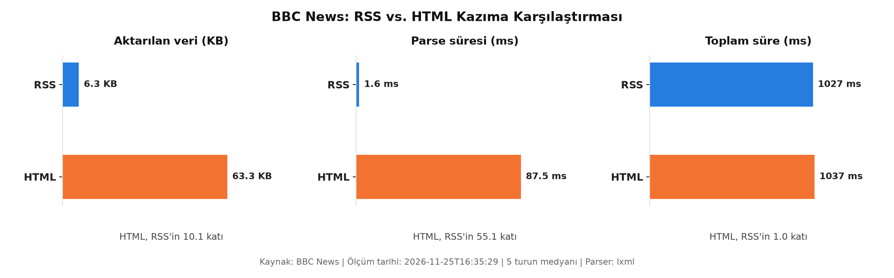

# RSS vs. Scraping Benchmark

BBC News üzerinden aynı haber başlıklarını RSS beslemesi ve HTML kazıma (scraping) ile çekerek aktarılan veri boyutu, ayrıştırma hızı ve kırılganlık farkını ölçen karşılaştırma aracı.

> Medium yazısı: `<Medium linki>`


## Kısaca sonuçlar

- **Aktarılan veri:** HTML sayfası, RSS beslemesine göre **10.1x** daha fazla sıkıştırılmış veri aktardı (`63.3 KB` vs `6.3 KB`; açılmış gövde `372.0 KB` vs `29.2 KB`).
- **Parse süresi:** HTML'i `BeautifulSoup` (`lxml`) ile ayrıştırmak, RSS XML'ini ayrıştırmaya göre **55.1x** daha uzun sürdü (`87.5 ms` vs `1.6 ms`).
- **Toplam süre:** Toplam istek süresi neredeyse aynı kaldı (**1.0x**, `1037 ms` vs `1027 ms`); çünkü belirleyici olan parse değil, ağ gecikmesiydi.



## Sonuç tablosu

`2026-11-25T16:35:29` tarihli ölçümün 5 turluk medyan değerleri (`parser: lxml`):

| Yöntem | Aktarılan veri | Açılmış boyut | İndirme | Parse | Toplam |
|---|---|---|---|---|---|
| RSS (XML) | 6.3 KB | 29.2 KB | 1025 ms | 1.6 ms | 1027 ms |
| HTML + BeautifulSoup | 63.3 KB | 372.0 KB | 949 ms | 87.5 ms | 1037 ms |

## Nasıl çalıştırılır

```bash
python -m venv .venv
# Windows (PowerShell):
.venv\Scripts\Activate.ps1
# macOS / Linux:
# source .venv/bin/activate

pip install -r requirements.txt
```

Ölçümü çalıştırmak, grafiği üretmek ve başlık + link listesini görmek için:

```bash
python benchmark.py --runs 5
python make_charts.py
python headlines.py
```

İsteğe bağlı olarak headless Chrome (Selenium) ile tüm sayfa yükünü (JS, CSS, görseller dahil) ölçmek için `selenium` paketini kurup şunu çalıştırabilirsiniz:

```bash
python benchmark.py --runs 5 --selenium
```

## Örnek çıktı

```text
[1] RSS  (https://feeds.bbci.co.uk/news/rss.xml)
  tur 1/5: 474 ms, 6.3 KB aktarım, 20 başlık
  tur 2/5: 307 ms, 6.2 KB aktarım, 20 başlık
  tur 3/5: 1043 ms, 6.2 KB aktarım, 20 başlık
  tur 4/5: 1027 ms, 6.3 KB aktarım, 20 başlık
  tur 5/5: 1079 ms, 6.3 KB aktarım, 20 başlık

[2] HTML + BeautifulSoup  (https://www.bbc.com/news)
  tur 1/5: 2196 ms, 63.3 KB aktarım, 20 başlık
  tur 2/5: 1365 ms, 63.3 KB aktarım, 20 başlık
  tur 3/5: 1037 ms, 63.3 KB aktarım, 20 başlık
  tur 4/5: 510 ms, 63.3 KB aktarım, 20 başlık
  tur 5/5: 533 ms, 63.3 KB aktarım, 20 başlık

Ölçüm zamanı: 2026-11-25T16:35:29 | 5 turun medyanı | parser: lxml

| Yöntem | Aktarılan veri | Açılmış boyut | İndirme | Parse | Toplam | Başlık |
|---|---|---|---|---|---|---|
| RSS (XML) | 6.3 KB | 29.2 KB | 1025 ms | 1.6 ms | 1027 ms | 20 |
| HTML + BeautifulSoup | 63.3 KB | 372.0 KB | 949 ms | 87.5 ms | 1037 ms | 20 |

Oranlar: HTML, RSS'e göre 10.1x daha fazla veri aktardı, 1.0x daha uzun sürdü.
RSS ile HTML'deki ilk 20 başlıktan 6 tanesi birebir aynı.

RSS'ten ilk 5 başlık:
  - Energy bills to rise by 26% from January after gas prices surge
  - Two men charged with trying to steal cufflinks and clock from Royal home
  - Third of young Brits have never had sex, but many are sexting and watching porn
  - Raheem Sterling given suspended jail sentence for dangerous driving and nitrous oxide possession
  - EU offers UK fresh deal on 'Made in Europe' scheme

Ham sonuçlar results/results.json dosyasına yazıldı.
```

## Yöntem

- Her yöntem için art arda **5 tur** ölçüm yapılır ve aykırı değerlerin etkisini azaltmak için **medyan** alınır.
- İki yöntemin eşit şartlarda başlaması için her turda yeni bir `requests.Session()` açılır (DNS ve TLS el sıkışması dahildir).
- Ağdan gelen sıkıştırılmış (`gzip`/`deflate`) bayt boyutu ile açılmış gövde boyutu ayrı ayrı ölçülür.
- XML ayrıştırma için `defusedxml.ElementTree` (kurulu değilse uyarı vererek `xml.etree.ElementTree`), HTML ayrıştırma için `BeautifulSoup` (`lxml`, kurulu değilse `html.parser`) kullanılır.

## Bulgular ve sınırlar

- **Ağ gecikmesi baskınlığı:** Parse süresi HTML tarafında 55.1x daha yavaş olsa da toplam süre farkı küçüktür; çünkü sürenin büyük kısmını ağ gecikmesi belirler.
- **İçerik farkı:** RSS ile ana sayfa her zaman aynı başlıkları aynı sırayla vermez; aynı haberin başlığı bile iki yerde farklı yazılabilir (bu ölçümde başlığa göre ilk 20'de 6 ortak çıktı). Bu nedenle `headlines.py` içinde sorgu parametreleri temizlenmiş **linke göre** karşılaştırma yer alır.
- **Kırılganlık:** HTML kazıyıcı tek bir CSS seçiciye (`[data-testid="card-headline"]`) bağlıdır; BBC sayfa yapısını değiştirdiğinde 0 başlık döndürebilir.
- **Ortam bağımlılığı:** İndirme süreleri ağ bağlantısına, günün saatine ve coğrafi konuma göre değişiklik gösterir.

## Yasal not

Bu proje kişisel ve eğitim amaçlıdır. BBC haber içeriklerinin tüm hakları BBC'ye aittir; sitenin kullanım koşullarına ve `robots.txt` kurallarına uyun, çekilen içeriği yeniden yayımlamayın. Betiklerde istekler arasında bekleme süresi (`time.sleep(1)`) uygulanmaktadır.

## Lisans

[MIT](LICENSE)

---

## English Summary

A lightweight Python benchmark comparing **RSS (`feeds.bbci.co.uk/news/rss.xml`)** vs. **HTML scraping (`bbc.com/news`)** across transferred payload size, parsing time, total latency, and selector fragility. Over 5 runs (median values), HTML transferred **10.1x** more compressed data (`63.3 KB` vs `6.3 KB`) and took **55.1x** longer to parse (`87.5 ms` vs `1.6 ms`), while total request time remained nearly identical (`1037 ms` vs `1027 ms`) due to network latency. Run `python benchmark.py --runs 5`, `python make_charts.py`, and `python headlines.py` to reproduce the measurements and charts locally.
